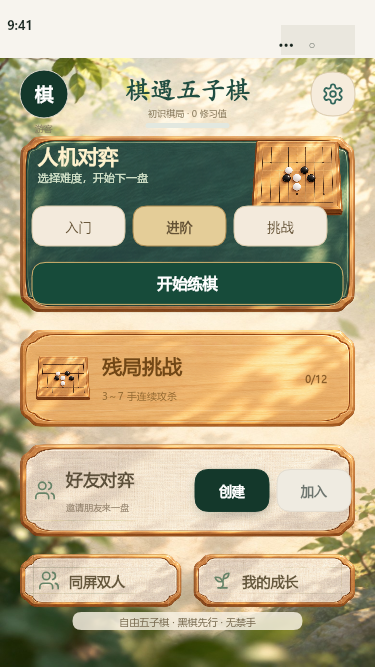

# RC17 大厅与残局设计

本次复调以负责人最新偏好的第一张概念图为风格方向：林间日光、实木棋桌、青玉与暖纸。吸收其美术气质，同时把人机难度和开始操作、残局、好友建房/加入直接放进首页，让棋盘只作为小插图。页面继续使用原有微信小游戏 Canvas；背景与控件素材分离，中文文本、触摸区和实际数据都由代码绘制。

## 真实页面

以下是同一套生产场景代码经桌面 Canvas 渲染的预览，含模拟的系统顶栏；不是微信真机截图。玩家资料弹层使用明确的合成预览账号。

[设置](previews/rc17/settings-375.png) · [头像资料](previews/rc17/profile-sheet-375.png) · [加入好友房](previews/rc17/join-room-375.png) · [小屏](previews/rc17/home-320.png) · [长屏](previews/rc17/home-430.png)

## 布局与交互

- 顶部紧凑头像、品牌和独立齿轮。头像展开详情与资料入口；游客的官方微信授权按钮仅覆盖头像。
- 人机区把三档难度和开始练棋放在同一入口；有存档时可继续，也可新开人机局。
- 残局使用独立的横向入口；好友房把创建和加入房间按钮直接展示在首页。下方并列同屏对弈与成长入口。
- 成长收在下方入口，首页不展示完整个人信息、战绩表或成长面板。
- 背景是低对比的庭院日光氛围图；面板是克制的木作、玉漆和暖纸纹理。小棋盘缩在主入口与残局入口内。图片异步读取、缓存复用；触摸释放才触发操作，弹层独占输入。
- 大厅棋子短暂入场，最多约 2.2 秒，重绘间隔不少于 42 ms，结束后静止。后台与离场取消帧，设置可关闭动效。
- 落子音效、背景音乐、自己落子震动分别控制。原创 12 秒轻声拨弦循环默认关闭，玩家触摸后才可播放；后台暂停，恢复时按开关继续，普通点击不重启音乐。

## 关卡与难度

旧 `p01`～`p12` 原局面、星级和奖励保留，归入“入门练习”。新增独立的 `c01`～`c12`，规定黑方 3、3、4、4、4、5、5、5、6、6、7、7 手内取胜，最后成五连的一手计入。

新题为原创组合局面和连续冲四研究题，分连续攻杀、转线推演、长链制胜。每章首题开放，章内逐题解锁；默认先进入烧脑挑战，熟练玩家可跳过旧教程。

`forcingSearch` 证明的是连续冲四链，不能将其结果说成覆盖所有安静着法的完整五子棋最优解。验证使用独立的棋盘胜负规则，逐层枚举所有合法白棋应手：离开必防点则黑方可立即成五，唯一继续防守点再递归验证下一段；另枚举初始所有黑棋落点，排除一步胜招与两手强制取胜的双胜点捷径。规定步数是关卡目标，不限制玩家必须按作者路线落子。

守方优先立即取胜、堵直接胜点，再搜索己方连续冲四反击或占据黑方攻杀入口，剩余局面使用挑战级 AI。搜索在棋盘副本上分片调度，可以取消，有节点与时间边界。所有合法替代胜法都按实际胜负判定通关，首次奖励与最好星级沿用原规则。

## 素材与参考

- `assets/lobby-sprites.png`：本轮生成的透明素材图集，约 1.24 MiB，包括深玉主面板、暖木残局面板、纸纹副面板和俯视棋盘插画。
- `assets/lobby-garden.jpg`：日光庭院的浅景背景，约 172 KiB；文字和操作区保持清晰。
- `assets/lobby-music.wav`：原创拨弦音列，由 `scripts/generate-lobby-music.py` 可复现生成，无外部录音采样。
- 图标从 [Lucide](https://lucide.dev/license) 0.468.0 转成少量原生 Canvas 路径，许可保留在 `assets/LUCIDE-LICENSE.txt`，运行时不引入 npm 依赖。
- 用户提供的游戏截图是主要视觉依据。网络检索资料包括 [王者荣耀官方大厅入口优化](https://www.taptap.cn/moment/644255183525642580)、[球球大作战入坑指南](https://wiki.biligame.com/bob/%E5%85%A5%E5%9D%91%E6%8C%87%E5%8D%97)、[贪吃蛇大作战应用页](https://app.mi.com/details?id=com.wepie.snake.new.mi)。部分远程图片直链无法读取，不将其当作已完整查看的画面证据。

## 验证边界

2026-10-08 已继续完成小屏安全区、字号与对比度、资源加载和大厅数据读取收尾；实际开发者工具已恢复基础库加载黑屏并走通设置、人机黑白落子与重开返回。自动门禁通过，覆盖可选资源失败、后台停止绘制、图片缓存与大厅重绘不重复读取原生存储。

`node scripts/verify-release.js` 包含 24 题解法、真实场景通关、首页与独立设置绑定、音频前后台、动画收尾与取消、四尺寸触摸区、头像弹层和原有联机回归。新增烧脑搜索在桌面测试中按 4 ms 目标分片；该测量不是手机性能结果。页面截图也使用真实绘制代码，但不能代替真机音频、手势、帧率和完整使用体验。

本轮不上传正式版本、不提交审核、不发布；未修改云函数、数据库或联网匹配功能。
