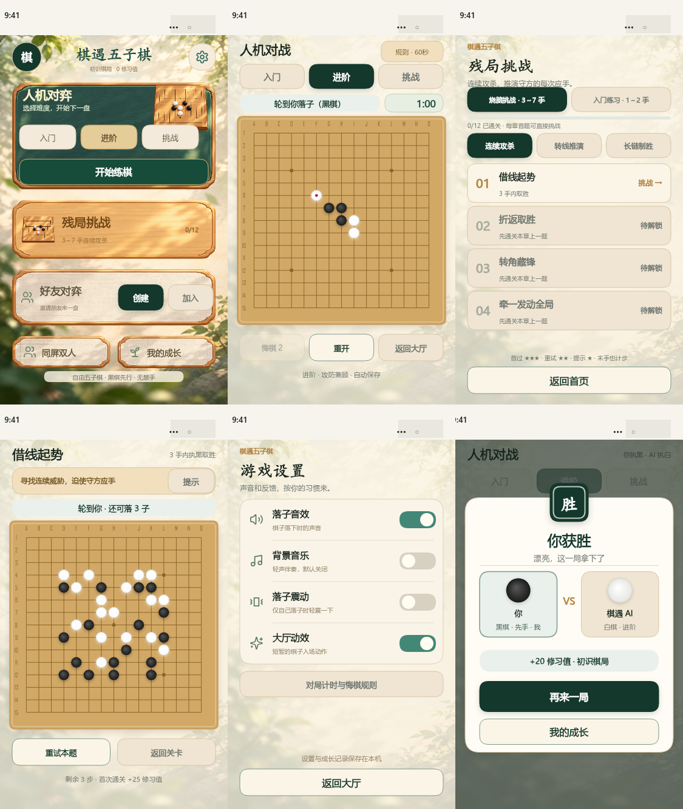

# RC18 对局规则与副页统一

本轮完成每步计时、超时判负、悔棋约束与副页风格统一。沿用首页认可的林间日光、青玉、实木与暖纸配色，副页降低背景对比度，保留棋盘和文字的清晰度。

## 规则

| 模式 | 计时 | 悔棋 |
| --- | --- | --- |
| 人机 | 玩家每步默认 60 秒，AI 思考不占玩家时间 | 每局最多两次，退回上一轮自己的落子和 AI 回应；AI 尚在思考时也能撤回自己的落子 |
| 同屏 | 当前落子方每步默认 60 秒 | 每方最多两次申请，撤回最近一手，必须由另一方在确认面板同意 |
| 好友 | 两人到齐后黑方开始计时，时限由房主开局前确定 | 轮到本人时可申请退回上一轮黑白两手；每方两次申请，拒绝或取消也消耗一次 |
| 残局 | 不限制思考时间 | 沿用重试和提示星级规则，不提供比赛悔棋 |

- 可选每步 30、60、120 秒或不限时。好友建房与同屏开局前有规则页；人机第一手前点击右上角规则入口调整。设置页可保存默认规则；已开始的对局规则保持不变。
- 超时立即判负。切后台停止绘制和搜索，但计时期限不暂停；人机存档保留计时与悔棋次数，恢复时检查超时。
- 悔棋不补回已用时间。人机与好友恢复原落子前剩余时间，再扣除当前回合已经消耗的思考/确认时间，并不超过当前剩余时间。同屏恢复撤回落子方当时剩余时间，扣除确认等待时间。若剩余时间已耗尽，按超时处理。
- 同屏和好友确认窗口最多 15 秒，未回应按拒绝处理。等待期间计时继续；申请待处理时禁止继续落子。结束对局不能悔棋。
- 再来一局清空棋盘并重置计时与申请次数；好友仍要求双方确认再战。

## 实现与兼容

- `utils/matchRules.js` 提供本地规则、截止时间格式化和每秒更新；`ruleRenderer.js` 绘制计时及悔棋确认；`MatchSetupScene` 展示开局/默认规则。
- 好友截止时间、落子顺序、申请次数、同意身份、申请过期和撤回两手均由云端事务校验。客户端校准服务器时间，显示归零后锁盘，等待云端结果。双方离线时在下一次同步/操作结算超时，截止时间保持原值。
- 悔棋历史保存在私有 `rooms`；公开视图只包含棋盘、显示资料、规则、截止时间与申请信息。申请携带随机 ID，重复/迟到同意不会再撤回棋子。
- 旧客户端创建的房间沿用不限时、无悔棋协议；旧房间和旧人机存档不强制开启时限。旧客户端不能加入新版规则房间，避免在不显示计时的情况下意外判负。
- 新版建房先核对云端规则能力，后端版本不匹配时提示并停止建房，不悄悄丢弃规则或留下临时房间。
- `roomAction-20261008-release-9` 已部署到现有环境，状态 Active。远端 `index.js`、`matchRules.js`、`package.json` 与本地原始字节/SHA-256 一致。部署前源码和回退目录保留在工程外 `D:\项目代码\_codex-audits\qiyu-rules-20261008`。

## 预览与验证

以下为生产 Canvas 场景经桌面渲染的画面；房间、资料和棋局是合成预览数据。

[规则设置](previews/rc18/rules-375.png) · [小屏规则](previews/rc18/rules-320.png) · [同屏](previews/rc18/local-375.png) · [悔棋确认](previews/rc18/undo-375.png) · [等待房间](previews/rc18/wait-room-375.png) · [好友对局](previews/rc18/online-375.png) · [成长](previews/rc18/growth-375.png) · [资料](previews/rc18/profile-375.png)

`node scripts/verify-release.js` 全部门禁通过。新增验证覆盖本地后台超时、AI 思考取消、悔棋后空盘仍保留额度/时间、无提示残局不受时限、四尺寸和安全区触摸区、服务器时间偏差、前后台迟到响应、超时/落子并发、重复同意、拒绝与确认过期、无补时、再战重置、关闭房间与公开视图隐私。云端并发测试使用本地事务模拟；部署核验是实际远端代码与状态核验，不冒充双账号真机测试。

客户端尚未上传或发布。真机重点检查：倒计时与后台返回、人机思考中/完成应手后的悔棋、同屏双方确认、好友双机同意/拒绝/15 秒超时/两次额度、弱网时归零锁盘与重连结果，以及小屏规则页。真实音频、震动、帧率及双机弱网仍待验收。
